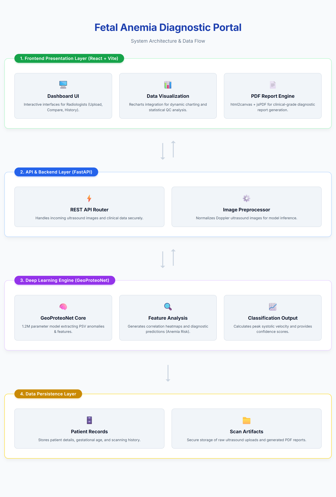

# GeoProteoNet — Fetal Anemia Detection

GeoProteoNet is a student project exploring Doppler ultrasound image analysis with computer vision and machine learning. It combines image-based model inference, derived hemodynamic features, and a web dashboard for reviewing results.

> Final-year B.E. major project at MJCET (2026), supervised by Ms. Nabeela Fatima.

**Research prototype only.** This project is not a medical device and must not be used to diagnose, treat, or make clinical decisions. The reported metrics below are experimental results from the project, not evidence of clinical validation.

## Overview

1. **Image analysis** — a TensorFlow/Keras CNN processes an uploaded image.
2. **Feature generation** — the pipeline prepares hemodynamic values such as PSV, EDV, RI, PI, and S/D ratio.
3. **Results dashboard** — a React interface presents the analysis, history, visualizations, and PDF exports.

## Architecture



| Area | Technologies |
| --- | --- |
| Frontend | React, Vite, Tailwind CSS, Recharts |
| API | Python, FastAPI, Uvicorn |
| Model and image processing | TensorFlow/Keras, NumPy, OpenCV |
| Data and reports | SQLAlchemy, SQLite, jsPDF, html2canvas |

## Reported experimental metrics

The earlier project evaluation reported:

- **Segmentation:** 93.99% Dice coefficient
- **Classification:** 92.90% F1-score

These values should be read alongside the dataset, split, labels, and evaluation method used. They have not been independently verified here and do not establish clinical performance or generalization to new populations.

## Run locally

Use Python 3.11 and a recent Node.js LTS release. The application creates its local SQLite database and uploads directory at runtime; those generated files are intentionally excluded from version control.

### 1. Configure local environment files

From the repository root, copy the templates:

```bash
cp backend/.env.example backend/.env
cp frontend/.env.example frontend/.env
```

On Windows, you can copy these files in File Explorer or use PowerShell's `Copy-Item` command. Add your own Gemini key to `backend/.env` if you need the optional Gemini integration. Frontend `VITE_*` values are delivered to the browser, so never put private credentials in them.

### 2. Start the backend

```bash
cd backend
python -m venv .venv
```

Activate the environment, then install dependencies and run the API.

**Windows (PowerShell):**

```powershell
.venv\Scripts\Activate.ps1
python -m pip install -r requirements.txt
python -m uvicorn main:app --reload
```

**macOS/Linux:**

```bash
source .venv/bin/activate
python -m pip install -r requirements.txt
python -m uvicorn main:app --reload
```

The API is available at `http://localhost:8000`; interactive API documentation is at `http://localhost:8000/docs`.

### 3. Start the frontend

In a second terminal:

```bash
cd frontend
npm install
npm run dev
```

Open the local URL printed by Vite (usually `http://localhost:5173`).

The exact output depends on the available model weights and local configuration. Predictions from this academic prototype must not be interpreted as clinical advice.

## Repository structure

```text
├── architecture.png
├── backend/
│   ├── main.py
│   ├── model_utils.py
│   ├── requirements.txt
│   └── .env.example
└── frontend/
    ├── src/
    ├── package.json
    └── .env.example
```

## Team

- Shaikh Mazein Ahmed
- Mohammad Owais
- Shaik Syed

Supervised by Ms. Nabeela Fatima, Department of Computer Science and Engineering, MJCET.

## License

MIT — see [LICENSE](./LICENSE).
